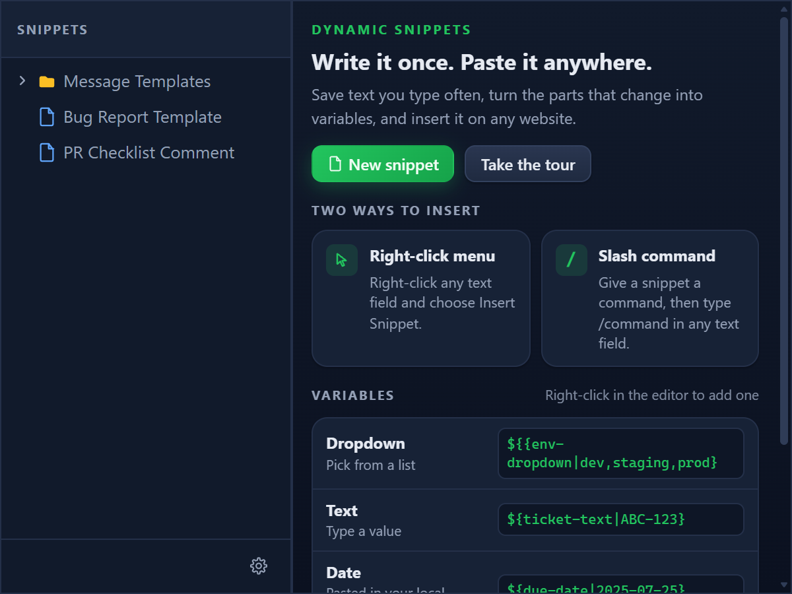
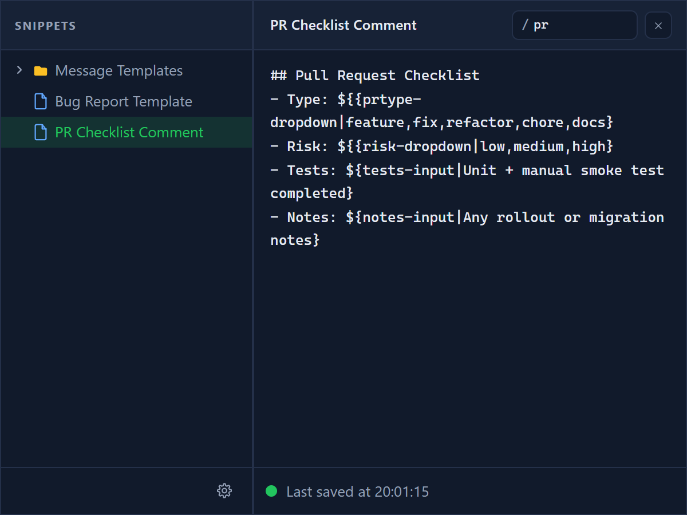
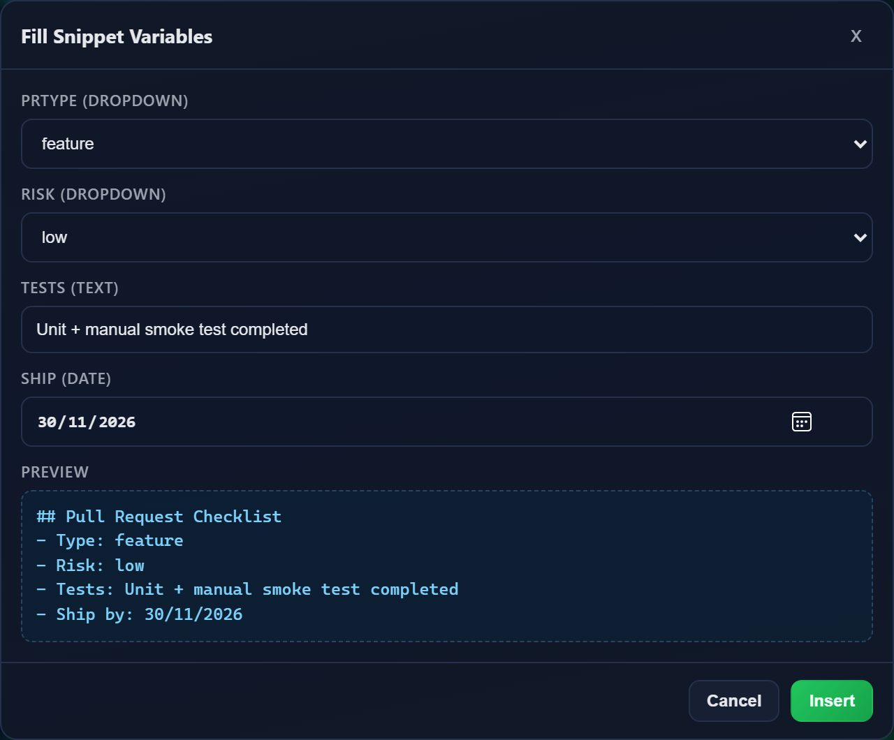
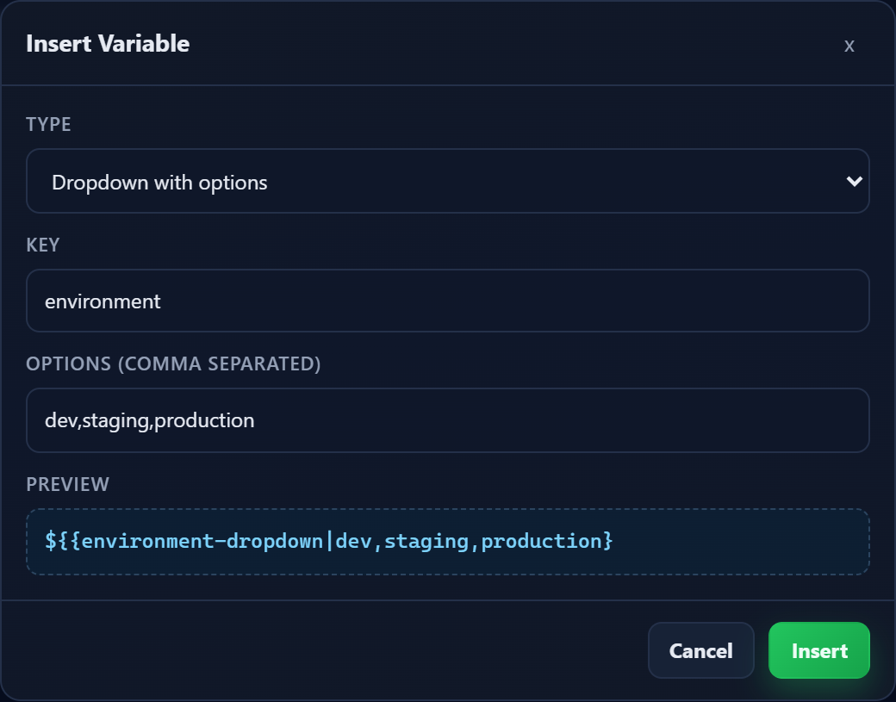
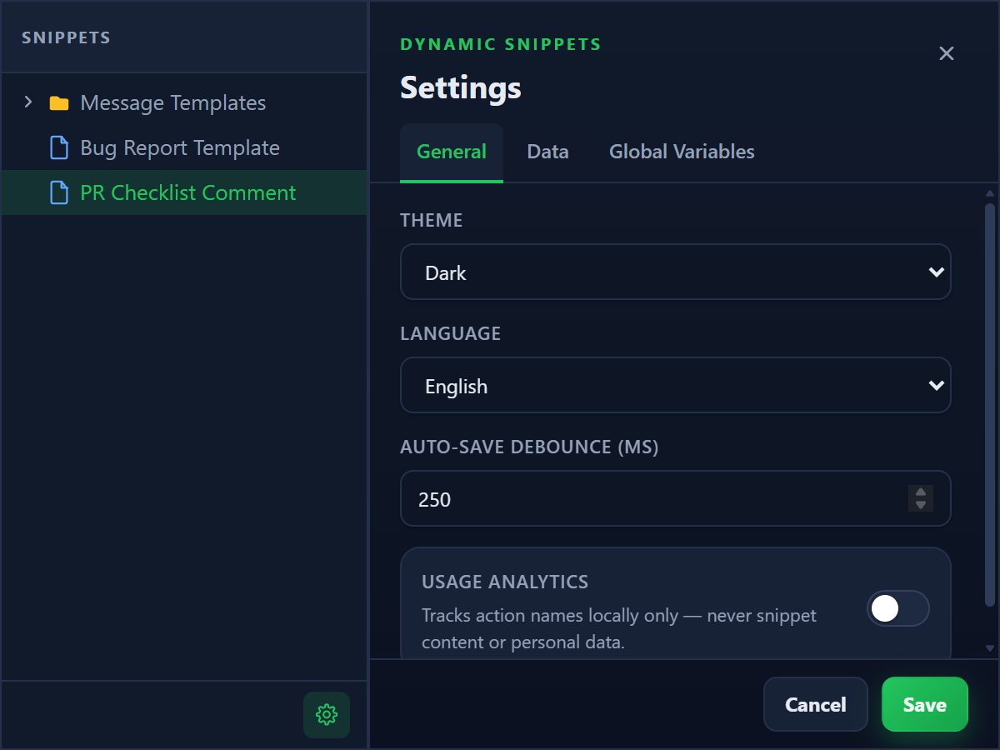
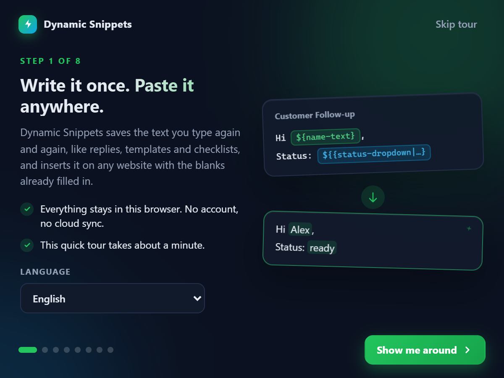
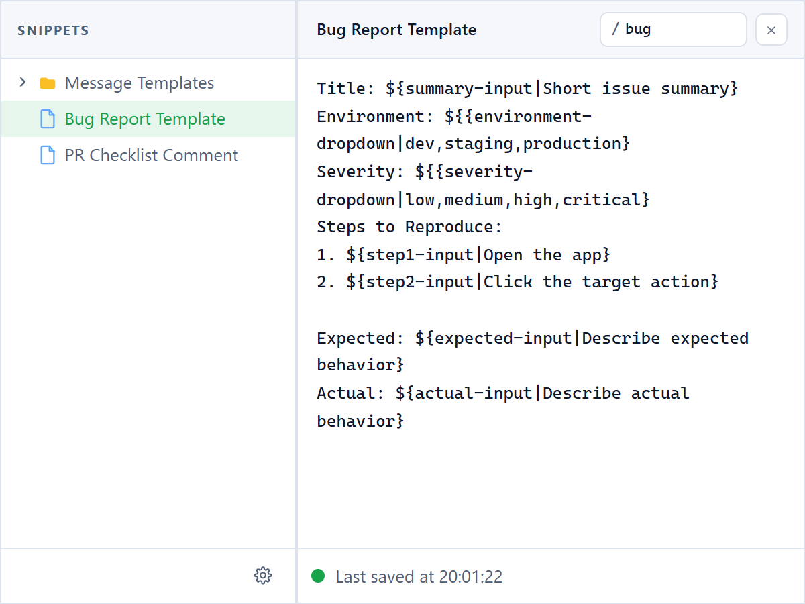

<div align="center">

# ⚡ Dynamic Snippets

**Save, organize, and instantly paste reusable text snippets with dynamic variables.**

[](https://chromewebstore.google.com/detail/lhpmacoeaepkocgkhamlnaalpifhckjm?utm_source=item-share-cb)
[](LICENSE)
[](https://vuejs.org)

<br />



</div>

---

## ✨ Features

| Feature | Description |
|---|---|
| ⚡ **Slash Commands** | Give a snippet a command, then type `/command` in any text field to insert it |
| 🖱️ **Right-Click Insert** | Insert any snippet from the browser's right-click menu, on any website |
| 🔀 **Dynamic Variables** | Dropdowns, text inputs and date pickers that you fill in when you insert |
| 🌐 **Global Variables** | Save values like your name or signature once and reuse them in every snippet |
| 🛠️ **Variable Builder** | Add variables from the editor's right-click menu. No syntax to memorize |
| 📁 **Folder Tree** | Organize snippets in nested folders with drag-and-drop |
| 💾 **Auto-Save** | Changes save as you type, with an adjustable delay |
| 📦 **Import / Export** | Back up or move your library, global variables and settings, with a preview and merge or overwrite options |
| 🎨 **Dark & Light Themes** | Switch themes from Settings |
| 🌍 **Multiple Languages** | English and Japanese, with community translations welcome |
| 🧭 **Guided Tour** | A short walkthrough on first launch, which you can replay from the welcome page |

## 📸 Screenshots

<div align="center">
<table>
<tr>
<td align="center"><br /><b>Snippet Editor</b></td>
<td align="center"><br /><b>Fill In Variables</b></td>
</tr>
<tr>
<td align="center"><br /><b>Variable Builder</b></td>
<td align="center"><br /><b>Settings</b></td>
</tr>
<tr>
<td align="center"><br /><b>Guided Tour</b></td>
<td align="center"><br /><b>Light Theme</b></td>
</tr>
</table>
</div>

## 🚀 Getting Started

### Install from the store

Get it from the [Chrome Web Store](https://chromewebstore.google.com/detail/lhpmacoeaepkocgkhamlnaalpifhckjm). It also works in Microsoft Edge.

### Build from source

**Prerequisites:** [Node.js](https://nodejs.org/) 18+ and npm.

Translations live in a separate repository that is included as a git submodule, so clone with `--recurse-submodules`:

```bash
git clone --recurse-submodules https://github.com/Chosen-Marsh/Dynamic-snippets.git
cd Dynamic-snippets
npm install
npm run build
```

If you already cloned without it, fetch the translations with:

```bash
git submodule update --init
```

Without the submodule the build still succeeds, but the interface shows translation keys instead of text.

### Load in your browser

1. Open `chrome://extensions` (Chrome) or `edge://extensions` (Edge).
2. Turn on **Developer mode**.
3. Click **Load unpacked** and select the `dist` folder.

After changing the code, run `npm run build` again and click the reload button on the extension's card.

### Preview the popup

```bash
npm run dev
```

This opens the popup in a normal browser tab, which is handy for quick UI work. Extension APIs aren't available there, so data is saved to the tab's `localStorage` instead, and right-click and slash-command insertion don't work.

## 🧩 How It Works

### Create a snippet

1. Click the extension icon to open Dynamic Snippets.
2. Right-click the sidebar and choose **New Snippet** or **New Folder**.
3. Write your text. To add a variable, right-click in the editor and choose **Add Variable**.
4. Optionally, type a command in the box next to the title, such as `bug`.

### Insert it anywhere

- **Right-click menu:** right-click a text field on any page, choose **Insert Snippet**, then pick a snippet. Folders appear as submenus.
- **Slash command:** type `/` followed by the command, such as `/bug`. Use <kbd>↑</kbd> <kbd>↓</kbd> to choose, <kbd>Enter</kbd> to insert and <kbd>Esc</kbd> to close.

If the snippet has variables, a form opens with a live preview. Fill it in and click **Insert**. If the page won't accept the text, it is copied to your clipboard instead.

### Variable syntax

You can type these directly, or use the variable builder in the editor.

| Type | Syntax | Example |
|---|---|---|
| Dropdown | `${{key-dropdown\|option1,option2}` | `${{env-dropdown\|dev,staging,prod}` |
| Text | `${key-text\|default}` | `${ticket-text\|ABC-123}` |
| Date | `${key-date\|YYYY-MM-DD}` | `${due-date\|2025-07-25}` |
| Global | `${key-global}` | `${username-global}` |

- The default value after `|` is optional for text and date variables.
- Dates are inserted in the browser's local date format.
- Global variables are set in **Settings → Global Variables** and are filled in without a prompt. A key with no value is inserted as `undefined`.
- `${key-input|default}` from older versions still works as a text variable.

## 🌍 Translations

The interface is available in English and Japanese. Translations are maintained in [Dynamic-snippets-locales](https://github.com/Chosen-Marsh/Dynamic-snippets-locales). Adding a language only takes one file, and no code changes are needed. See that repository's README to contribute.

## 🏗️ Tech Stack

| Technology | Purpose |
|---|---|
| [Vue 3](https://vuejs.org/) | Popup interface, using the Composition API |
| [Vite](https://vite.dev/) | Builds the popup, service worker and content script |
| Chrome Extension MV3 | Service worker, context menus, scripting and content scripts |
| `chrome.storage.local` | Local storage. No external servers |

### Project structure

```
public/manifest.json      Extension manifest
popup.html                Popup entry page
src/
  popup/                  Popup app shell
  components/             Vue components (sidebar, editor, settings, tour, ...)
  services/               Storage, snippets, settings and import/export
  background.js           Service worker: right-click menu and insertion
  background/             Helpers the service worker injects into pages
  content/slashCommands.js  Content script for /command insertion
  variables/              Variable token parsing
  i18n/                   Translation loader; locales/ is the submodule
  changelogs/             Release notes shown in Version history
  theme.css               Color and style tokens for both themes
```

## 🔒 Privacy

Dynamic Snippets doesn't collect or send your data. Snippets, folders, global variables and settings are stored only in your browser. There's no account and no cloud sync. See the full [Privacy Policy](PRIVACY.md).

## 📄 License

CC BY 4.0 © [Marsh](https://github.com/Chosen-Marsh) — Commercial use is permitted with attribution. You may use, adapt, and redistribute the project in personal, educational, or commercial contexts, as long as the license terms are followed.
